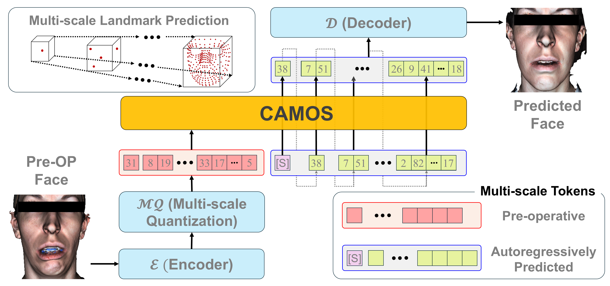
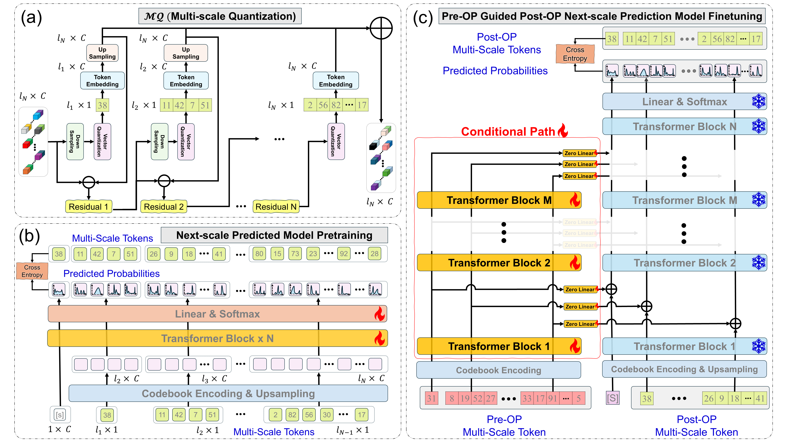

# CAMOS: Conditional Autoregressive Modeling for Orthognathic Surgery

**Facial Appearance Prediction with Conditional Multi-scale Autoregressive Modeling for Orthognathic Surgical Planning**  
Jungwook Lee, Xuanang Xu, Daeseung Kim, Tianshu Kuang, Hannah H. Deng, Xinrui Song, Yasmine Soubra, Rohan Dharia, Michael A.K. Liebschner, Jaime Gateno, Pingkun Yan  

---

## Overview
CAMOS is a deep learning framework for predicting **patient-specific optimal 3D facial appearance** from preoperative face for **orthognathic surgical planning**.  
It uses a **hierarchical coarse-to-fine multi-scale autoregressive approach**, pretrained on a large-scale dataset of 44,602 normal faces and fine-tuned on in-house patient dataset, to produce realistic and harmonized facial predictions.

---

## Key Features
- **Hierarchical Multi-scale Prediction**: Coarse-to-fine refinement for better detail and facial harmony.
- **Large-scale Pretraining**: Robust generative modeling on diverse facial demographics.
- **Conditional Generation**: Patient-specific prediction using preoperative facial landmarks.
- **3D Surface Reconstruction**: Outputs full 3D facial meshes for surgical planning.
  
---

## Method
1. **Multi-scale VQ-VAE** extracts hierarchical latent tokens from facial landmarks.  
2. **Visual Autoregressive Modeling (VAR)** predicts next-scale tokens from coarse to fine.  
3. **Conditional Fine-tuning** integrates patient preoperative data.  
4. **Thin-Plate Spline (TPS)** reconstructs the 3D surface.

  

---

## Dataset
- **Pretraining**: DAD-3DHeads, Headspace, FaceScape, BU-3DFE (total 44,602 faces).
- **Fine-tuning**: 86 orthognathic surgery patients (in-house dataset).

Due to privacy concerns, patient data is not publicly released.

---

## Results
- **Chamfer Distance**: 1.91 mm (lips), 2.37 mm (chin) – best among compared methods.
- Generates **realistic, patient-specific** postoperative predictions with fine details and correct alignment.

---

## Installation
Tested with Python 3.9.

```bash
conda create -n camos python=3.9 -y
conda activate camos
pip install -r requirements.txt
```

On a headless Linux server (no display) replace the VTK wheel with the OSMesa build:
```bash
pip uninstall -y vtk
pip install --extra-index-url https://wheels.vtk.org vtk-osmesa==9.3.1
```

## Inference from your own STL
`run_camos.py` takes a preoperative facial surface and writes the predicted postoperative surface.

**Input**: a facial soft-tissue surface in STL (CT segmentation or 3D photograph), in millimetres,
aligned in natural head position: the face looks toward **-y**, the top of the head points to **+z**, patient-left is **+x**.

```bash
python run_camos.py \
  --stl    patient/Face.stl \
  --out    results/patient \
  --mvqvae MVQVAE_PATH \
  --cvar   CAMOS_PATH
```

| option | meaning |
|---|---|
| `--cvar A.pt B.pt ...` | average the predictions of several checkpoints |
| `--crop` | also save the cropped facial region |
| `--device cuda:0` | run the networks on a GPU (default: CPU) |
| `--sparse-views` | 25 instead of 81 rendered views (faster) |

**Output** (in the coordinate frame of the input STL):

| file | content |
|---|---|
| `Face_predicted.stl` | predicted postoperative surface |
| `Face_landmarks478_pre.mrk.json` | dense landmarks detected on the input (3D Slicer markup) |
| `Face_landmarks282_pre.mrk.json`, `Face_landmarks282_predicted.mrk.json` | model input / predicted landmarks |
| `Face_camos.json` | run settings |

Pipeline: 81 off-screen renderings of the mesh → MediaPipe FaceLandmarker (478 points) → back-projection onto the mesh
and multi-view merging → 282 landmarks → multi-scale VQ-VAE tokens → conditional VAR (coarse-to-fine) → predicted landmarks →
TPS deformation of the input mesh. The normalization statistics are computed from the preoperative landmarks.

## Training
To train CAMOS model:

```bash
python train.py \
  --fold 0 \
  --experiment_dir EXPERIMENT_FOLDER \
  --mvqvae_path VQVAE_PATH \
  --pretrained_path CAMOS_PRETRAIN_PATH \
  --data_path1 DATA_PATH1 \
  --data_path2 DATA_PATH2
```
Training additionally needs `pip install -r requirements-train.txt`.

## Inference on a prepared dataset
To run fold-wise inference on a dataset prepared as in the paper and save predictions to JSON:
```bash
python Inference.py \
  --mvqvae_path VQVAE_PATH \
  --cvar_path MODEL_PATH \
  --data_path1 DATA_PATH1 \
  --data_path2 DATA_PATH2 \
  --save_path SAVE_FOLDER
```

## Citation

```bibtex
@inproceedings{lee2025camos,
  title     = {Facial Appearance Prediction with Conditional Multi-scale Autoregressive Modeling for Orthognathic Surgical Planning},
  author    = {Lee, Jungwook and Xu, Xuanang and Kim, Daeseung and Kuang, Tianshu and Deng, Hannah H. and Song, Xinrui and Soubra, Yasmine and Dharia, Rohan and Liebschner, Michael A.K. and Gateno, Jaime and Yan, Pingkun},
  booktitle = {Medical Image Computing and Computer Assisted Intervention (MICCAI)},
  year      = {2025}
}
```

## Acknowledgments
This work was supported by the National Institutes of Health (NIH) under awards R01DE027251 and R01DE021863.
The VAR implementation builds on [FoundationVision/VAR](https://github.com/FoundationVision/VAR); landmark detection uses [MediaPipe](https://github.com/google-ai-edge/mediapipe).

---
